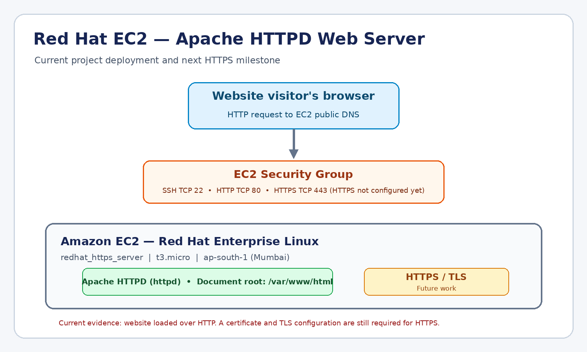

# Red Hat HTTPS Server — Apache HTTPD Deployment

## 1. Project overview

This project documents the work completed to create an Amazon EC2 virtual machine running Red Hat Enterprise Linux and host a website using Apache HTTP Server (HTTPD).

The work began with launching and configuring an EC2 instance, connecting to it from Windows PowerShell over SSH, updating the operating system, installing Apache HTTPD, and preparing the website files in Apache's default document root. A browser screenshot supplied for this project shows the website loading from the EC2 public DNS over **HTTP**.

The EC2 instance is named `redhat_https_server` because HTTPS is the intended next milestone. **HTTPS has not yet been configured or tested.** This repository records the completed HTTP deployment accurately and identifies HTTPS as pending work.

## 2. What was done

### 2.1 Created the EC2 instance

An EC2 instance was launched in AWS with the following details visible in the supplied AWS screenshots and setup conversation:

| Configuration | Value |
|---|---|
| Instance name | `redhat_https_server` |
| Instance ID | `i-0e55958816a54fee7` |
| Operating system | Red Hat Enterprise Linux; RHEL 9 was selected during setup |
| Instance type | `t3.micro` |
| AWS Region | `ap-south-1` — Asia Pacific (Mumbai) |
| Availability Zone | `ap-south-1b` |
| VPC ID | `vpc-0f54d0425fe448b23` |
| Subnet ID | `subnet-09d3d724cfef060c3` |
| Security group ID | `sg-09a7f315d129ea887` |
| Public DNS shown | `ec2-65-0-105-76.ap-south-1.compute.amazonaws.com` |
| SSH login user | `ec2-user` |
| Key pair name shown by EC2 | `redhat-https-serverkey` |

The instance reached the `Running` state. The supplied connection-details screenshot shows **3/3 status checks passed**.

> Public IPv4 addresses and public DNS names can change after a stop/start unless an Elastic IP is associated. Treat the values above as the values captured during this lab, not permanent identifiers.

### 2.2 Configured SSH access from Windows

The instance was accessed from Windows PowerShell using the private key file downloaded at launch.

The local key file used in the successful connection command was:

`redhat-https-serverkey.pem`

The key file was stored in `D:\Downloads`. SSH initially refused to use it because Windows permissions allowed other accounts to access the private key. The permissions were corrected with:

```powershell
cd D:\Downloads
icacls "redhat-https-serverkey.pem" /inheritance:r
icacls "redhat-https-serverkey.pem" /grant:r "$($env:USERNAME):(R)"
```

The SSH connection command was:

```powershell
ssh -i "redhat-https-serverkey.pem" ec2-user@ec2-65-0-105-76.ap-south-1.compute.amazonaws.com
```

After connecting as `ec2-user`, the session was switched to the root account for system administration:

```bash
sudo -i
```

**Security note:** The `.pem` private key is not included in this repository and must never be committed to GitHub.

### 2.3 Updated Red Hat

The operating system package update was run as root:

```bash
dnf update -y
```

The update completed. The terminal output indicated that a newer kernel had been installed and that a reboot would be needed for the new kernel to take effect. A reboot is not claimed as completed in this documentation.

### 2.4 Installed and started Apache HTTPD

On Red Hat Enterprise Linux, the Apache package and systemd service are named `httpd`.

The installation and service commands used in the lab were:

```bash
dnf install httpd -y
systemctl start httpd
systemctl enable httpd
systemctl status httpd
```

- `dnf install httpd -y` installs Apache HTTPD.
- `systemctl start httpd` starts the web server immediately.
- `systemctl enable httpd` configures it to start automatically when the instance boots.
- `systemctl status httpd` checks the service state.

### 2.5 Prepared the website document root

Apache's default document root on this Red Hat installation is:

```text
/var/www/html
```

The website file was edited from the root shell using the `vi` editor:

```bash
cd /var/www/html
vi index.html
```

In `vi`, the workflow was:
1. Press `i` to enter insert mode.
2. Paste or type the HTML source.
3. Press `Esc` to leave insert mode.
4. Type `:wq` and press Enter to save and exit.

The supplied browser screenshot shows a website branded **FilmSpace** loading from the EC2 public DNS. The documentation uses the screenshot as evidence of the browser test; the exact deployed HTML source was not supplied as a separate file and is therefore not reproduced here.

### 2.6 Tested the website over HTTP

The website was opened in a browser using the EC2 public DNS:

```text
http://ec2-65-0-105-76.ap-south-1.compute.amazonaws.com
```

The browser screenshot shows the page loaded and the browser labelled the connection **Not secure**. This is consistent with HTTP rather than HTTPS.

A local server-side test can also be performed with:

```bash
curl -I http://localhost
curl http://localhost
```

The browser screenshot is the evidence included in this repository for the public HTTP website test.

## 3. How the deployment works



1. A visitor opens the EC2 public DNS name in a browser.
2. The request reaches the EC2 instance through the configured network path and security group.
3. Apache HTTPD receives the HTTP request.
4. Apache serves the website content from `/var/www/html`, including `index.html`.

## 4. Network and security group notes

The intended inbound access for this project is:

| Purpose | Protocol | Port | Recommended source |
|---|---|---:|---|
| SSH administration | TCP | 22 | My IP only |
| HTTP website | TCP | 80 | `0.0.0.0/0` |
| HTTPS website — future stage | TCP | 443 | `0.0.0.0/0` |

The exact inbound rule list was not visible in the supplied screenshots, so this table describes the required/recommended project configuration rather than asserting that every rule was verified.

If the Red Hat host firewall (`firewalld`) is active, HTTP can be allowed with:

```bash
systemctl is-active firewalld
firewall-cmd --permanent --add-service=http
firewall-cmd --reload
```

Run the firewall commands only after checking the firewall state. AWS security group rules and the operating-system firewall are separate controls.

## 5. HTTPS — planned next milestone

The instance name includes `https`, but the work captured in the supplied evidence currently demonstrates HTTP only.

HTTPS still requires server-side TLS configuration and a certificate. Merely allowing inbound TCP port 443 in an EC2 security group does not enable HTTPS.

A typical next-stage plan is:

1. Obtain a domain name that you control.
2. Point its DNS record to the EC2 instance (preferably use an Elastic IP so the address remains stable).
3. Confirm inbound TCP 80 and 443 are allowed as required.
4. Install and configure a trusted TLS certificate, for example through Let's Encrypt using a supported Certbot installation method for the selected RHEL release.
5. Configure Apache to serve HTTPS on port 443.
6. Optionally redirect HTTP traffic to HTTPS.
7. Test the certificate and browser connection, and configure certificate renewal.

A self-signed certificate can be used for learning, but browsers will show a trust warning. It is not the same as a publicly trusted certificate.

## 6. Screenshots included

| File | What it demonstrates |
|---|---|
| `screenshots/01-ec2-instance-overview.jpg` | EC2 instance list, instance name, type and running state |
| `screenshots/02-ec2-connection-details.jpg` | EC2 connection details, public DNS, SSH username, key pair and status checks |
| `screenshots/03-website-browser-http.jpg` | FilmSpace website loaded from the EC2 public DNS over HTTP |

## 7. Commands reference

```bash
# Update operating system packages
dnf update -y

# Install Apache HTTPD
dnf install httpd -y

# Start Apache now and enable it at boot
systemctl start httpd
systemctl enable httpd

# Check Apache service status
systemctl status httpd

# Go to Apache's default website directory
cd /var/www/html

# Edit the homepage
vi index.html

# Test locally
curl -I http://localhost
curl http://localhost
```

## 8. Current project status

### Completed in this lab

- [x] Launched the Red Hat EC2 instance.
- [x] Selected RHEL 9 during the instance setup workflow.
- [x] Used a `t3.micro` instance in `ap-south-1`.
- [x] Waited for EC2 status checks to pass.
- [x] Connected from Windows PowerShell using SSH and the PEM key.
- [x] Fixed Windows private-key file permissions.
- [x] Switched to root for system administration.
- [x] Ran `dnf update -y`.
- [x] Installed Apache HTTPD and ran the service start/enable commands.
- [x] Edited the website file under `/var/www/html` using `vi`.
- [x] Opened the website using the EC2 public DNS over HTTP.

### Not completed yet

- [ ] Capture final `systemctl status httpd` output as a project screenshot.
- [ ] Capture the final deployed `index.html` source from the instance.
- [ ] Record and verify the exact EC2 security group inbound rules.
- [ ] Configure a domain name and stable public IP (if required).
- [ ] Install and configure a trusted TLS certificate.
- [ ] Enable and verify HTTPS on port 443.
- [ ] Test HTTP-to-HTTPS redirection and certificate renewal.

## 9. Repository safety

Do not upload:
- PEM or PPK private keys
- AWS access keys or secret keys
- Passwords, session tokens or credentials
- TLS private-key files

The `.gitignore` file excludes common private-key and credential file patterns.
